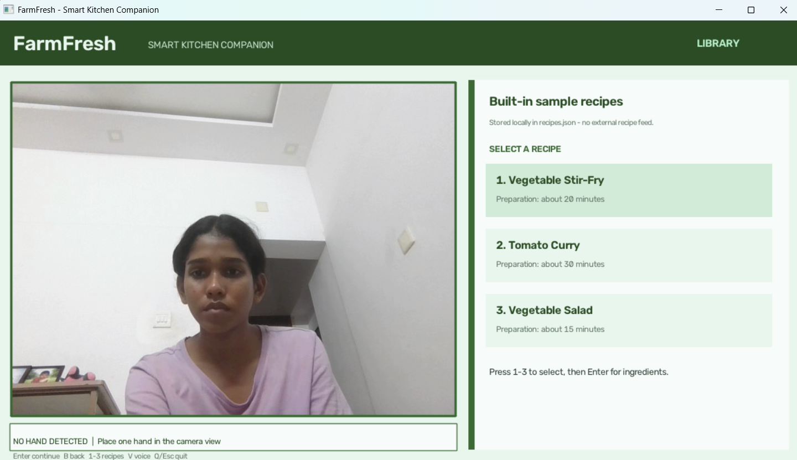
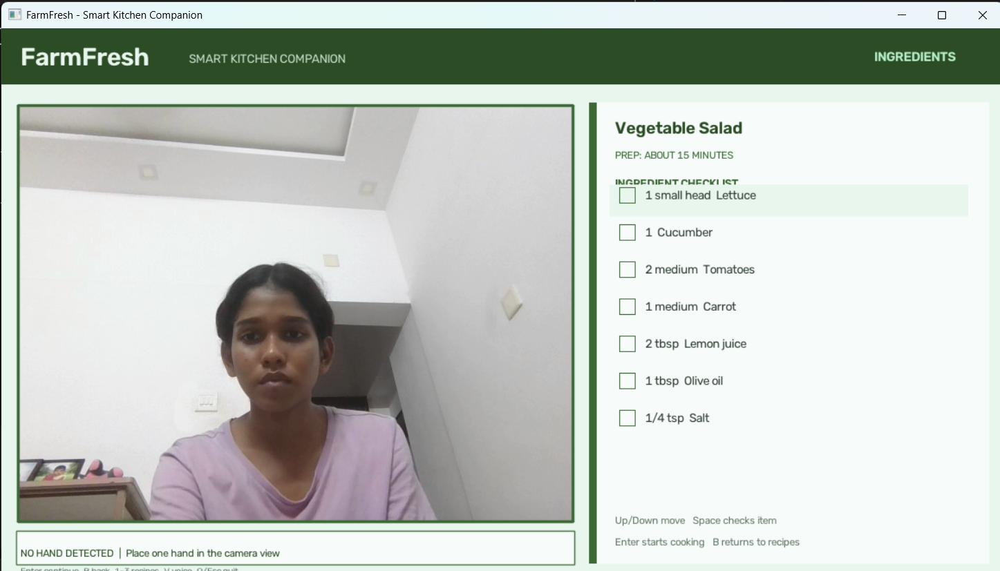
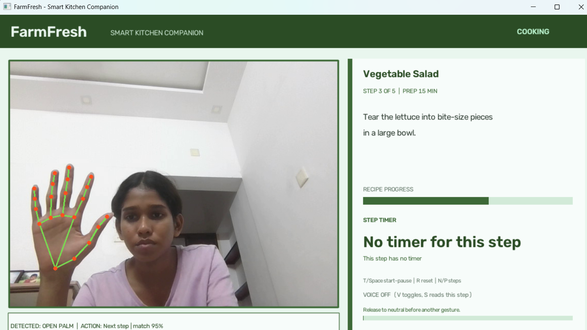

# SHN-MEDIAPIPE


# FarmFresh - Smart Kitchen Companion

FarmFresh is a Windows webcam cooking assistant for TinkerHub Saturday Hack Night, Sprint 01: Beyond Gesture. It keeps the current instruction visible while your hands are busy. The three built-in sample recipes are stored locally in `recipes.json`; recipes are not fetched from an external service.

## Project links and setup

- **Live website:** N/A (desktop webcam application)
- **GitHub repository:** [SHN-MEDIAPIPE](https://github.com/hridyasadanand/SHN-MEDIAPIPE)
- **Contributor:** Hridya Sadanand (@hridyasadanand)
- **Hardware:** Webcam (camera index 0)

### Install on Windows

Use Python 3.14 and PowerShell in the project folder:

```powershell
py -3.14 -m venv venv
.\venv\Scripts\Activate.ps1
python -m pip install -r requirements.txt
```

If activation is blocked by PowerShell, run the project with the environment interpreter directly:

```powershell
.\venv\Scripts\python.exe -m pip install -r requirements.txt
.\venv\Scripts\python.exe farmfresh.py
```

### Start the app

```powershell
python farmfresh.py
```

On first launch, FarmFresh downloads MediaPipe's `hand_landmarker.task` model. An internet connection is needed for this initial download. Later launches reuse the model. Allow webcam access and close other applications using the camera.

## Cooking workflow

1. **Recipe library:** Choose Vegetable Stir-Fry, Tomato Curry, or Vegetable Salad. Each card shows its approximate preparation time.
2. **Ingredients:** Review quantities and mark items as prepared with the checklist.
3. **Cooking:** Follow one instruction at a time, with step number, recipe progress, timer, and gesture status visible beside the webcam.

All sample recipe names, quantities, steps, and optional step timer durations are in `recipes.json`. The ingredient checklist is kept in memory for the current session.

## Controls

| Screen | Input | Action |
| --- | --- | --- |
| Any | `1`-`3` | Select a sample recipe |
| Recipe library | Up/Down arrows | Highlight a recipe |
| Recipe library | `Enter` | Open its ingredient checklist |
| Ingredients | Up/Down arrows | Select an ingredient |
| Ingredients | `Space` | Mark/unmark selected ingredient as prepared |
| Ingredients | `Enter` | Start cooking |
| Ingredients | `B` | Return to recipe library |
| Cooking | Open palm | Next cooking step |
| Cooking | Pinch thumb and index finger | Previous cooking step |
| Cooking | `N` / `P` | Next / previous step fallback |
| Cooking | `Enter` | Next step fallback |
| Cooking | `T` or `Space` | Start or pause this step's timer |
| Cooking | `R` | Reset this step's timer |
| Cooking | `V` | Enable/disable voice instructions |
| Cooking | `S` | Read the current instruction aloud |
| Cooking | `B` | Return to the ingredient checklist |
| Any | `Q` or `Esc` | Close FarmFresh |

Hold open palm or pinch steadily until recognition completes. Relax to a neutral pose before triggering another gesture. Only open palm and pinch control recipe steps. The timer controls are available for steps that define a `timer_seconds` value in `recipes.json`; a Windows sound alert plays when the countdown ends.

Voice is off by default. When enabled, FarmFresh uses Windows' built-in `System.Speech` through PowerShell and adds no Python speech package.

## Architecture

- `farmfresh.py` opens the camera with OpenCV, converts each frame for MediaPipe Tasks `HandLandmarker`, and draws the landmarks.
- Palm-relative landmark geometry recognizes open palm and pinch; `GestureDebouncer` confirms consecutive frames and prevents repeated actions while a pose is held.
- `recipes.json` supplies the local recipe library, ingredient quantities, instructions, and optional timers.
- The application state moves among recipe-library, ingredients, and cooking screens. OpenCV draws the interface; Python's monotonic clock runs the step timer.

## Screenshots

### Recipe selection

Browse the three built-in recipes and their preparation times.



### Ingredient checklist

Review ingredient quantities and mark ingredients as prepared before cooking.



### Cooking screen

Follow the current cooking step, track recipe progress, and use the timer and gesture controls.



---

**Built with curiosity at Saturday Hack Night.**
